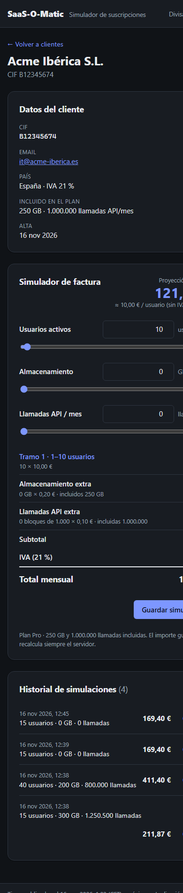
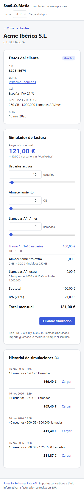

# Conversación con la IA: extractos literales

Los vibe-logs son un resumen redactado durante el trabajo. Esta carpeta guarda **texto literal** de la conversación real con Claude Code, para que se pueda contrastar con ellos.

- **Fuente:** la transcripción de la sesión que Claude Code guarda en local (JSONL), de una única sesión el 16 nov 2026, de 09:03 a 16:00.
- **Horas en CET** (hora peninsular), las mismas que muestra `git log`. La transcripción las guarda en UTC.
- **Extracción:** con un script de solo lectura. Los mensajes del usuario aparecen tal cual, con sus erratas. Las respuestas largas de la IA se recortan, y cada recorte se marca con `[…]`. No hay nada reescrito.
- **Limitación:** algunos mensajes intermedios de la IA no quedaron guardados como texto, solo sus comandos y resultados. Cuando pasa, se citan los comandos y su salida literal en lugar de reconstruir el mensaje.

Cuatro momentos, elegidos porque en ellos se decide algo o se corrige un error:

| # | Hora | Momento | Commit |
|---|------|---------|--------|
| 1 | 09:04 | La IA pregunta y el usuario decide las reglas de negocio ambiguas | `a02d28c` |
| 2 | 10:08 | El usuario propone añadir calidad y CI; Playwright se ofrece y se aplaza | `5671a79` |
| 3 | 12:43 | "No carga la página": un falso verde en la prueba de Docker | `4b2624f` |
| 4 | 13:37 | Revisión externa: la IA da por confirmado un fallo que no lo era, y el test lo desmiente | `3f3c5a3` … `5b3cb72` |

---

## 1 · Decisiones de negocio: las toma el usuario (09:04 → commit `a02d28c`, 09:21)

Tras leer el PDF del enunciado, la IA no eligió sola lo que el enunciado dejaba abierto. Preguntó, con opciones y su efecto:

> **¿Cómo afecta el 'Plan Elegido' al precio?**
> - *Plan con incluidos (Recommended)*: Basic/Pro/Enterprise: cada plan incluye cierta cantidad de almacenamiento y llamadas a la API, el exceso se cobra como extra; los tramos de usuarios no cambian
> - *Solo etiqueta*: El plan se guarda pero no afecta al cálculo: es la interpretación literal del PDF
> - *Multiplicador*: Cada plan aplica un factor sobre el coste por tramos
>
> **¿El almacenamiento y las llamadas a la API influyen en el coste?**
> - *Sí, como extras*: Precio por GB y por cada 1.000 llamadas por encima de lo que incluye el plan; queda documentado como supuesto propio
> - *No, solo se guardan*: Interpretación literal: el coste base sale solo de los usuarios

Respuesta registrada (09:09):

```
"¿Qué stack usamos? (Hay Node 20 y Python 3.12 disponibles)"="TS monorepo (Recommended)",
"¿Cómo afecta el 'Plan Elegido' al precio?"="Plan con incluidos (Recommended)",
"¿El almacenamiento y las llamadas a la API influyen en el coste?"="Sí, como extras",
"¿En qué idioma quieres el código, la UI y la documentación de ai-workspace?"="Código EN, docs/UI ES"
```

Desde la primera pregunta se avisó de que los extras serían un **supuesto propio**. La revisión externa (momento 4) pidió marcarlo también en la interfaz, y se hizo en `786fb74`.

---

## 2 · Calidad y CI: iniciativa del usuario (10:08 → commit `5671a79`, 10:24)

> **Usuario:** antes de seguir, yo añadiria controles de calidad y ci/cd, esta la opcion de hacer estos tests cada vez que se hace un commit en el repo en github, nos sirve para este proyecto? o habria tests que no se pueden hacer?

> **IA:** Sí, encaja bien con el proyecto, y todos los tests que tenemos pueden ejecutarse en CI. […]
>
> ## Qué no conviene meter en CI
> - **La API real de tipos de cambio** (fase 5). Si los tests llamaran a `open.er-api.com`, la CI fallaría cada vez que ese servicio cayera o cambiaran los tipos. La simularemos en los tests […]
> - **Las pruebas manuales que he ido haciendo**: `curl` contra servidores arrancados y revisión visual o responsive. Lo primero se puede automatizar con E2E (Playwright, que arranca los servidores dentro de la CI), aunque añade bastante peso. Lo visual sigue siendo revisión humana.
>
> ## CD
> En esta prueba no aporta casi nada. […]

La IA ofreció cuatro controles y el usuario eligió tres:

```
"¿Qué controles de calidad añadimos además de typecheck, tests, build y audit?"="ESLint (Recommended), Cobertura mínima, Prettier"
```

**E2E con Playwright quedó fuera.** Es exactamente lo que la revisión externa echó en falta (momento 4), y se añadió entonces con aprobación explícita.

---

## 3 · "No carga la página": un falso verde (12:43 → commit `4b2624f`, 12:46)

La prueba de humo de Docker estaba en verde, pero el usuario mandó una captura con un 404:

> **Usuario:** no carga la pagina *(captura adjunta: "Access Error: 404 -- Not Found" en localhost:8080)*

> **IA:** Esa página **no es de nginx ni de nuestra app**. "Access Error: 404 -- Not Found / Cannot locate document" es el formato de error de otro servidor web. Sospecho que **hay otro programa escuchando en el puerto 8080** de tu equipo: es el mismo fenómeno de Windows que vimos con el 3000 […]

> **IA:** Reproducido: la prueba corregida **falla** contra el 8080 compartido, que es exactamente lo que veías en el navegador. Ahora el arreglo del despliegue:

> **IA:** […] Ese servicio escuchaba por IPv4 y Docker por IPv6, en el mismo puerto. `localhost` puede resolverse por cualquiera de las dos vías:
> - Tu navegador fue por IPv4 y llegó a ese otro servicio, que es el que te devolvía el 404.
> - Mi prueba usó IPv6 y llegó a nuestra app, así que salía en verde.
>
> Esto **fue un fallo mío**: es el mismo problema de Windows que ya me encontré con el puerto 3000 en `npm run dev`, y no lo tuve en cuenta al montar Docker.
>
> ## Qué he cambiado
> 1. **Primero corregí la prueba** para que compruebe IPv4 explícitamente y verifique que IPv4 e IPv6 sirven la misma app. Contra el 8080 compartido **falló** […]
> 2. **La app pasa a usar el puerto 4180 por defecto.** […]

Primero se corrigió la prueba hasta que reprodujo el fallo, y solo después se arregló el despliegue.

---

## 4 · Revisión externa: verificarla, también contra la propia IA (13:37 → commits `3f3c5a3` … `5b3cb72`)

> **Usuario:** le he pedido a una fuente externa que lo revise y este ha sido su veredicto, revisalo y dime que piensas *(PDF adjunto: 89/100)*

La IA hizo una captura con Edge en modo headless a 390 px y concluyó:

> **IA:** **El fallo responsive es real.** Esta es la captura a 390 px del detalle de cliente: la página entera desborda por la derecha. […] Ese fallo es mío.
>
> | 3 | **Un test E2E real en navegador** | ✅ De acuerdo, y su argumento es el mejor posible: es justo el tipo de fallo que ninguno de nuestros tests podía ver. Lo había dejado aplazado en la fase de calidad. Requiere una dependencia nueva […], así que necesito tu aprobación según `CLAUDE.md` |
>
> ## Cómo lo abordaría
> 1. **Primero el E2E con Playwright, en rojo** […] Así queda demostrado que el test detecta el fallo actual antes de arreglarlo.

> **Usuario (14:49):** Me parece bien el plan que propones, en cuanto al limite en la busqueda, lo que mas me convence es la opcion de "ver más", añade playwright

El E2E no salió en rojo:

> **IA (14:54):** Ha pasado en verde a 390 px, y eso no cuadra con la captura de Edge. Antes de fiarme del test, saco una captura con Playwright para ver qué está midiendo.

Salida literal de esa medición con Playwright a 390 px (`sw` = ancho de la página, `iw` = ancho de la ventana):

```
{ sw: 390, bw: 390, iw: 390, wide: [], ofx: 'visible/visible' }
```

| Captura de Edge headless (la que se dio por buena) | Captura de Playwright a 390 px reales |
|---|---|
|  |  |

La de Edge es el diseño de escritorio recortado: en modo headless, el navegador no maqueta por debajo de unos 500 px de ventana. Después vino un barrido de 320 a 1440 px y con móviles emulados, cuya salida literal fue `sweep done` (ningún ancho desbordaba). Luego un peor caso deliberado (320 px, valores máximos, MXN), con esta salida:

```
MXN 320 {"sw":321,"iw":320,"wide":[]}
```

Ese sí era un fallo real, y se arregló con su test en rojo primero. Tras el push, el usuario avisó:

> **Usuario (15:46):** ha fallado el test de ci de e2e en github

En el runner de GitHub las fuentes son más anchas y el arreglo, ajustado a las medidas de unas fuentes concretas, se quedaba corto por 2 px. Se rehízo para que no dependiera de la fuente (`b3812b1`). El detalle completo de este momento está en el [vibe-log 10](../vibe-log/10-external-review.md).
